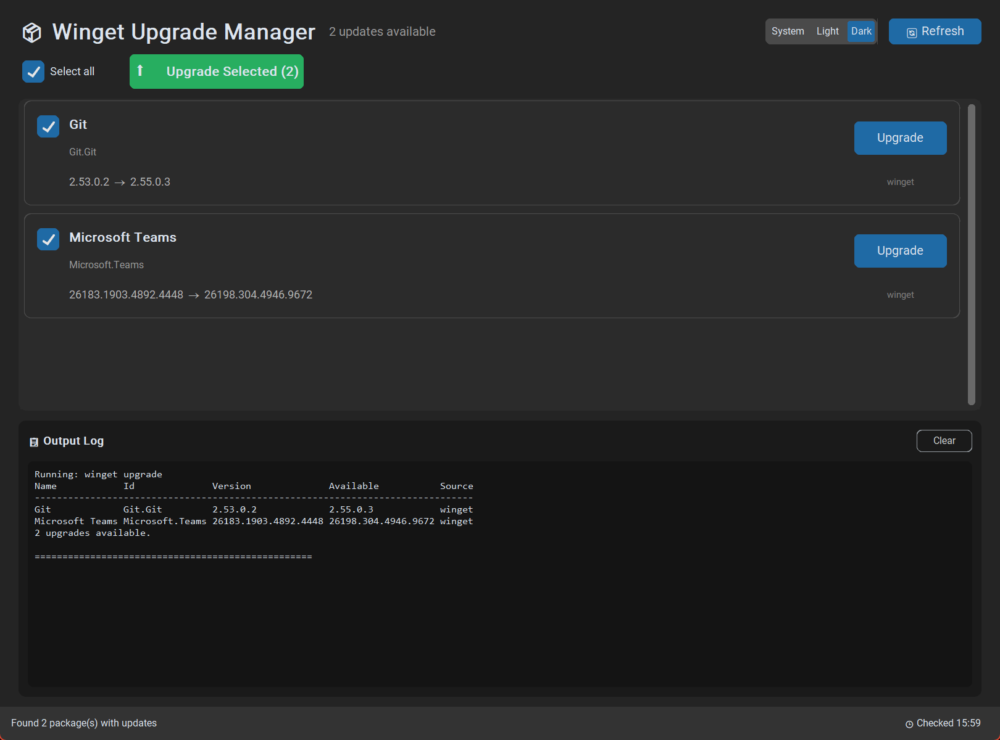

# 📦 Winget Upgrade Manager

A modern desktop GUI for managing Windows package upgrades via winget — with dark and light themes.


[](https://github.com/Dsgj/winget-upgrade-gui/actions/workflows/ci.yml)

<p align="center">
  <strong>Stop using the command line for package updates!</strong><br>
  A beautiful, intuitive interface for Windows Package Manager (winget).
</p>



---

## ✨ Features

- 📋 **Package List View** — All available updates in a clean card-based layout
- ☑️ **Pick What You Upgrade** — Per-package checkboxes with *Upgrade Selected*, or upgrade one package with a click
- 🧠 **Remembered Skips** — Packages you deselect stay deselected on future scans
- 💬 **Clear Failure Reasons** — When an upgrade fails you see *why* (app running, needs admin, disk full, pinned, …) mapped from winget's documented return codes, right on the package card
- 🔒 **App-In-Use Detection** — If the app you're upgrading is running, you get a yes/no prompt to close it first (graceful close, force only if needed) so the installer doesn't fail on locked files
- 📊 **Real-Time Progress** — Download and installation progress per package and overall
- 🛑 **Safe Cancel** — Stop a batch upgrade; the package in flight finishes cleanly first
- 📜 **Live Console** — Full winget output in the integrated console
- 🌍 **Locale-Independent** — Parses winget output structurally, so it works on non-English Windows too
- 🌙 **Dark / Light / System Theme** — Switch anytime; your choice is remembered
- 📌 **Pinned Package Awareness** — Pinned packages are shown (deselected by default) instead of silently hidden

---

## 📥 Installation

### Option 1: Download Executable (Recommended)

1. Go to [Releases](https://github.com/Dsgj/winget-upgrade-gui/releases)
2. Download the latest `WingetUpgradeManager.exe`
3. Run it — no installation needed!

### Option 2: Run from Source

**Requirements:**

- Windows 10/11
- Python 3.8 or higher
- [winget](https://learn.microsoft.com/en-us/windows/package-manager/winget/) (Windows Package Manager)

```powershell
# Clone the repository
git clone https://github.com/Dsgj/winget-upgrade-gui.git
cd winget-upgrade-gui

# Install dependencies
pip install -r requirements.txt

# Run the application
python main.py
```

---

## 🔨 Building from Source

```powershell
# Install build dependencies
pip install -r requirements-dev.txt

# Run the build script (embeds the icon and version metadata)
python build.py
```

The executable will be created at `dist/WingetUpgradeManager.exe`. The release
CI workflow runs this same script, so a local build matches a released one.

> **Note:** The executable will be approximately 50-80 MB due to the bundled Python runtime and GUI libraries.

---

## 🖥️ Usage

1. **Launch** — The app automatically scans for available updates on startup
2. **Refresh** — Click 🔄 Refresh to check again
3. **Select** — Tick the packages you want (deselections are remembered)
4. **Upgrade** — Click ⬆️ *Upgrade Selected*, or the *Upgrade* button on a single card
5. **If something fails** — The reason appears on the package card and in the output console

Settings and logs live in `%LOCALAPPDATA%\WingetUpgradeManager\`
(`config.json`, `app.log`).

---

## 📁 Project Structure

```text
winget-upgrade-gui/
├── main.py              # Application window and orchestration
├── ui_components.py     # Custom UI components
├── winget_runner.py     # winget execution, parsing, return-code mapping
├── process_guard.py     # Detects/closes running apps before upgrading
├── config.py            # Persisted settings + logging
├── version.py           # Single source of truth for the version
├── build.py             # Build script (used locally and by CI)
├── assets/icon.ico      # Application icon
├── tests/               # Parser and return-code tests
├── requirements.txt     # Runtime dependencies
├── requirements-dev.txt # Build/test dependencies
└── .github/workflows/   # CI (lint/test/build) and release automation
```

---

## 🔐 Security

- ✅ **100% Open Source** — All code is visible and auditable
- ✅ **No Telemetry** — Zero data collection
- ✅ **No Network Requests of Its Own** — The app only runs local `winget` commands; downloads are performed by winget
- ✅ **CI-Built Releases** — Executables are built on GitHub's infrastructure by the [release workflow](.github/workflows/release.yml), with SHA256 checksums and [build provenance attestation](https://docs.github.com/en/actions/security-for-github-actions/using-artifact-attestations) published alongside

See [SECURITY.md](SECURITY.md) for verification instructions.

---

## 🤝 Contributing

Contributions are welcome! See [CONTRIBUTING.md](CONTRIBUTING.md) for guidelines.
Notable changes are tracked in [CHANGELOG.md](CHANGELOG.md).

---

## 📝 License

This project is licensed under the MIT License — see the [LICENSE](LICENSE) file for details.

---

## 🙏 Acknowledgments

- [CustomTkinter](https://github.com/TomSchimansky/CustomTkinter) — Modern UI library
- [winget](https://github.com/microsoft/winget-cli) — Windows Package Manager
